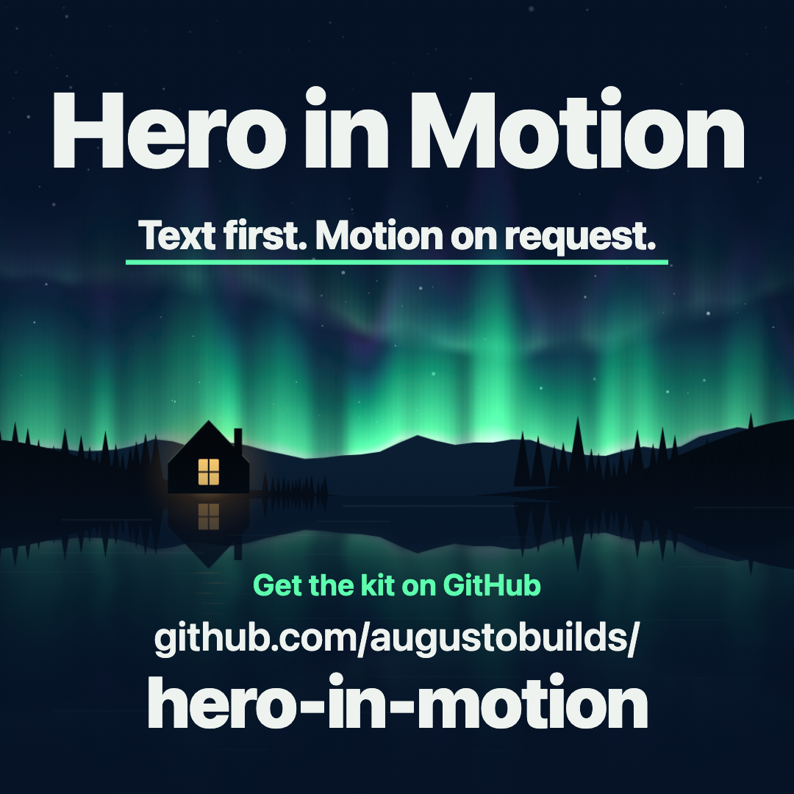

# Hero in Motion

**A homepage hero that is complete without its video and plays it only when a visitor asks. No autoplay, nothing downloaded until Play, it pauses itself, it respects reduced motion, and a missing file doesn't break it.**

You write a small JSON file with your headline, button and media paths. The kit writes the hero: a whole page, or a block to paste into the site you already have. It needs Python 3.9 and nothing else.

[Guide](guides/quick-start.en.md) · [Guía en español](guides/quick-start.es.md) · [Customize it](guides/variations.md) · [Prepare your video](guides/prepare-your-video.md) · [Make the clip with code](guides/make-the-film.md)

**[Try the live demo](https://augustobuilds.github.io/hero-in-motion/):** press Play and watch its meter of video fetched leave 0 B. Then open [the autoplay version](https://augustobuilds.github.io/hero-in-motion/autoplay.html) of the same hero and watch that meter without pressing anything.

## Watch the sample

<a href="media/hero-in-motion-demo.mp4"></a>

*[The 16-second sample film](media/hero-in-motion-demo.mp4), with a soundtrack made in code. The same cut renders square, vertical (9:16) and wide (16:9). It is drawn by [`film/explainer.html`](film/explainer.html) from the kit's own labels, colours and poster, so you can watch it live in a browser and render it yourself: [Make the hero clip with code](guides/make-the-film.md). It is an illustration of the page, not a screen recording.*

<details>
<summary>Text version of the film</summary>

1. **What most heroes do:** `<video autoplay muted loop>`. 258 kB fetched before you asked (the size of this example's own clip, [measured](#measured)).
2. **Autoplay is rude.** Make your hero wait.
3. **Press Play.** The whole page is on screen: the words, the button, and the picture with Play on it. The pointer presses Play and the example's northern lights come alive and fill the frame (an illustration of the page, not a screen recording).
4. **And then it moves.**
5. **Text first.** The headline is plain HTML: `<h1>Nights worth staying up for.</h1>`.
6. **0 B.** Bytes of video fetched until you press Play (`preload="none"`).
7. **Scroll it away: paused.** "Paused. Press Play to resume when ready."
8. **Reduced motion? Starts still.** The picture and the music stop for this beat.
9. **Video missing? The page stays usable.**
10. **One JSON.** `python3 scripts/build_hero.py examples/hero.json --output output/hero.html`: `Wrote output/hero.html`. Python 3.9+, nothing to install.
11. **End card:** Hero in Motion. Text first. Motion on request. Get the kit on GitHub: github.com/augustobuilds/hero-in-motion.

</details>

## What you get

- **Text first.** The headline, summary and button are plain HTML. They work with no JavaScript, no video and no image.
- **Nothing loads until Play.** The video has no `src` and `preload="none"`. Captions and the WebM copy wait for the same press.
- **It pauses itself.** Playback stops when the tab is hidden or the picture scrolls away, and it never resumes on its own.
- **Reduced motion.** If the visitor asks for less motion, the hero says so and stays still until they press Play.
- **Missing files are fine.** A missing video shows a message and keeps the poster. A missing poster shows your description of it.
- **A real button.** One `<button>` on the picture that switches between Play and Pause, with a focus ring and a status line that screen readers hear at every step.
- **Three layouts, your colours.** Text beside the picture, text above it, or text over a full-width picture. `accent` sets the button's colour, and the builder refuses one its label can't be read on. `focus` keeps your subject in view when the picture is cropped. Light and dark mode follow the system.
- **Three examples.** Lake cabins, a swim school and a night radio station: each is one JSON file and a poster drawn in code.
- **English and Spanish** control labels, and a place to add more.

## Measured

| | Video fetched before anyone presses Play | After Play |
| --- | --- | --- |
| The kit's hero ([live](https://augustobuilds.github.io/hero-in-motion/)) | **0 B** | 258 kB, the whole 10-second clip as WebM (683 kB as MP4) |
| The same hero with `autoplay` ([live](https://augustobuilds.github.io/hero-in-motion/autoplay.html)) | **258 kB**, on every visit | |

Before Play the kit's hero needs about 54 kB in all: its HTML, styles and script (13 kB) and the poster (41 kB). These are the bytes a local server sent to a headless Chromium, counted by `scripts/measure_page.py`; [validation.json](validation.json) records the run. Measure your own page the same way (it needs Playwright, set up as in [the film guide](guides/make-the-film.md)):

```sh
python3 scripts/measure_page.py output/hero.html
```

## Quick start

```sh
git clone https://github.com/augustobuilds/hero-in-motion.git
cd hero-in-motion
mkdir -p output
python3 scripts/build_hero.py examples/hero.json --output output/hero.html
cp -f examples/poster.svg docs/lantern-lake.mp4 output/
```

You should see `Wrote output/hero.html`. Open it in a browser (`open output/hero.html` on macOS, `xdg-open` on Linux).

Press **Play video**: the northern lights move for ten seconds, then the poster returns. Now delete `output/lantern-lake.mp4`, reload and press Play again: the hero says the video is unavailable and keeps the poster. That is the designed behaviour. The clip is the poster's own picture set in motion by code. To render it yourself (this step needs Playwright and FFmpeg, set up as in [the film guide](guides/make-the-film.md)):

```sh
python3 scripts/render_film.py --format clip --output output/lantern-lake.mp4 --overwrite
```

## Make it yours

Copy `examples/hero.json`, change the words and point it at your own files:

```json
{
  "lang": "en",
  "title": "Northwind Coffee",
  "headline": "Roasted on Monday. At your door by Friday.",
  "summary": "Small-batch coffee from one roaster in Leeds.",
  "cta_label": "See this week's roast",
  "cta_href": "/shop",
  "video": "./roastery.mp4",
  "poster": "./roastery.jpg",
  "poster_alt": "A roaster pours beans from a steel drum into a cooling tray.",
  "layout": "cover"
}
```

```sh
python3 scripts/build_hero.py my-hero.json --output output/index.html
```

Put the poster and the video beside the page under those names. Optional fields add a `badge` line, a `details` section, your `accent` colour, a `focus` point for a cropped picture, `captions`, a `video_webm` copy, `sound` and a picture `ratio`. Every field and its rules are in [the guide](guides/quick-start.en.md#3-the-configuration-contract). Two more examples, `examples/swim.json` and `examples/radio.json`, show the stacked and cover layouts with their own colours.

### Paste it into a site you already have

```sh
python3 scripts/build_hero.py my-hero.json --output output/hero-block.html --fragment
```

`--fragment` writes only the hero: one `<style>`, the markup and one `<script>`. Every style rule and every id starts with `hm`, so it doesn't restyle your page or collide with it. The only other id is `details`, on the optional details section. Paste it where the hero goes; it inherits your site's font. [Customize it](guides/variations.md) has notes for React, Astro and WordPress.

### No video yet? Make one from your poster

```sh
python3 scripts/render_film.py --format clip --poster my-poster.svg --output output/my-clip.mp4
```

If your poster is an SVG, this renders a 10-second clip of it that starts and ends on the poster, so the switch to video can't be seen. The poster says how it moves: put `data-move`, `data-sway`, `data-zoom`, `data-turn` or `data-pulse` on the parts that should drift, rock, grow, turn or dim, as `examples/poster-swim.svg` and `examples/poster-radio.svg` do. A poster with none of these gets a slow push-in. It needs Playwright and FFmpeg; [Prepare your video](guides/prepare-your-video.md#no-video-yet-make-one-from-your-poster) has the details.

### Check your video before you ship it

```sh
python3 scripts/inspect_media.py output/roastery.mp4 --check
```

With FFmpeg installed, `--check` judges the file against a hero's budget: no longer than 20 seconds, no heavier than 300 kB per second, no taller than 1080 px, and its index at the front so playback can start before the whole file arrives. Each failed check prints the FFmpeg command that fixes it. [Prepare your video](guides/prepare-your-video.md) has the full recipe, including the poster frame.

## Tests

```sh
python3 -m unittest discover -s tests -v
```

The run ends in `OK (skipped=16)` with nothing extra installed, or `OK (skipped=14)` if FFmpeg is installed: 14 browser tests need Playwright and FFmpeg, and 2 inspector tests need FFmpeg.

## Limitations

- **The builder doesn't make video.** It builds the hero around a video you supply. `render_film.py` can set an SVG poster in motion, and that is all: it doesn't film, edit or generate footage. Rendering needs Playwright and FFmpeg.
- The measured numbers come from one browser (headless Chromium) over a local connection. Other browsers fetch video in their own steps; none of them fetches it before Play, because the page gives the video no address until then.
- `--check` judges numbers. It can't tell you whether the video looks good, what it shows, or whether you have the rights to it.
- Captions are shown whenever you supply them; there is no button to turn them off.
- Only English and Spanish control labels are built in.
- Test your real page before shipping: keyboard only, reduced motion, missing files, a phone, a hidden tab and scrolling.

## More

- [The live demo](https://augustobuilds.github.io/hero-in-motion/), built from `examples/` by `scripts/build_demo.py` into `docs/`
- [Every file in the repository, and troubleshooting](guides/reference.md)
- [Prompts for a coding agent](prompts/recreate-and-remix.md), with [AGENTS.md](AGENTS.md), [SKILL.md](SKILL.md) and [llms.txt](llms.txt)
- [What was run on this version](validation.json) and [where each file came from](provenance.json)

## Where to go next (affiliated, optional)

> **Disclosure:** the author of this kit also builds the three products below. None of them is needed to use the kit, and the kit never contacts them or sends them data.

- **[ProcVideos](https://procvideos.com/)** shows examples of videos made with code, if you are looking for ideas for the clip in your hero.
- **[Attain OS](https://attainos.com/)** is a workspace for organizing briefs, tasks and docs for a site launch.
- **[AttainSoft](https://attainsoft.co/)** does custom engineering, if you want this hero integrated into your site or framework for you.

## License

[MIT](LICENSE) © 2026 Augusto Burgos. The template, scripts, poster, guides and diagram are original to this repository. See [provenance.json](provenance.json).
