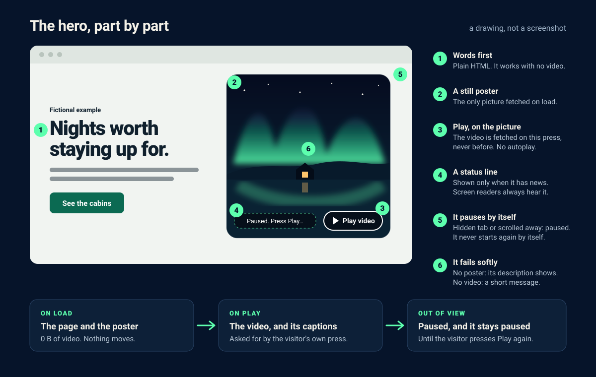

# Hero in Motion: guide

[Español](quick-start.es.md) · [Back to README](../README.md)



## 1. Build the example page

You need Python 3.9 or newer and a browser. Nothing else is installed and nothing touches the network. From the repository root:

```sh
mkdir -p output
python3 scripts/build_hero.py examples/hero.json --output output/hero.html
cp -f examples/poster.svg docs/lantern-lake.mp4 output/
python3 -m unittest discover -s tests -v
```

You should see `Wrote output/hero.html` (if you already built it from the README, you get `File exists` instead: that is fine, or add `--overwrite`) and the tests ending in `OK (skipped=16)`, or `OK (skipped=14)` if FFmpeg is already installed: the 14 browser tests need Playwright and FFmpeg and two inspector tests need FFmpeg, so they run only once those are installed. For the Spanish example, use `examples/hero.es.json`, `examples/poster-es.svg` and `output/hero-es.html`. Open `output/hero.html` (`open` on macOS, `xdg-open` on Linux). Invalid input exits with code `2` and a one-line `error:` message. The builder refuses to overwrite an existing file (add `--overwrite` to replace it) and never writes over its own input.

## 2. Try the failure cases on purpose

The page is designed to stay useful when things go wrong. Try each case:

| Try this | What you should see |
| --- | --- |
| Delete `output/lantern-lake.mp4`, reload and press **Play video** | A message on the picture saying the video is unavailable; poster and text stay. |
| Delete `output/poster.svg` and reload | Your `poster_alt` text in the media panel instead of the poster (with JavaScript on). |
| Turn on reduced motion in your OS and reload | A message on the picture saying nothing moves until you choose Play; Play still works if pressed. |
| Disable JavaScript and reload | No Play button and no message; headline, summary, button and details all still work. |
| Press Play, then switch tabs or scroll the panel away | Playback pauses and doesn't resume when you come back. |
| Let the video play to the end | The poster returns with a message that the video finished, and pressing Play starts it again. |
| Tab through the page with the keyboard | A visible focus ring on the CTA and the Play button. |

The example's video, `docs/lantern-lake.mp4`, is the clip the [live demo](https://augustobuilds.github.io/hero-in-motion/) plays: the poster's northern lights, 10 seconds. To render it yourself, run
`python3 scripts/render_film.py --format clip --output output/lantern-lake.mp4 --overwrite`. That
needs Playwright and FFmpeg, set up as in [make-the-film.md](make-the-film.md).

## 3. The configuration contract

Required fields:

| Field | What it takes |
| --- | --- |
| `lang` | `en` or `es` (any language in the `UI` dictionary of `scripts/build_hero.py`). Sets the page language and the button and status labels. |
| `title` | The page title. Unused with `--fragment`, but still required. |
| `headline`, `summary` | The hero's words. |
| `cta_label`, `cta_href` | The button's label and where it goes: a section (`#pricing`), a path on your site (`/pricing`, `./about.html`) or an `https://` link. |
| `video` | A simple path to an `.mp4`, such as `./hero.mp4` or `/assets/hero.mp4`. |
| `poster` | A simple path to an `.svg`, `.jpg`, `.jpeg`, `.png`, `.webp` or `.avif`. |
| `poster_alt` | A description of the poster. It is the image's alternative text, and it is shown in the picture's place if the poster fails to load. |

Optional fields:

| Field | What it adds |
| --- | --- |
| `badge` | A short line above the headline, such as "New" or "Fictional example". |
| `details` | A section under the hero with the id `details`, so `cta_href` can be `#details`. |
| `layout` | `split` (text beside the picture, the default), `stacked` (text above the picture) or `cover` (text over a full-width picture). |
| `ratio` | The picture's shape, such as `16:9`, `4:3` or `1:1`. The default is `1:1` for `split` and `16:9` for `stacked`. `cover` fills the hero and ignores it. |
| `focus` | The part of the picture to keep in view when it is cropped, as two percentages: across, then down. `70% 40%` keeps a subject right of centre. The default is the middle. |
| `accent`, `accent_dark` | The colour of the button and the focus ring, in light and in dark mode, such as `#0b5a9e`. The builder refuses a colour the button's label could not be read on (it needs a contrast of 4.5 to 1). |
| `captions` | A simple path to a `.vtt` file. It is fetched on the first Play, and the captions are shown. |
| `video_webm` | A simple path to a `.webm` copy. Browsers that can play it fetch it in place of the MP4. |
| `sound` | `true` plays the video with its sound and adds a Mute button. The default, `false`, plays it muted. |

A simple path starts with `./` or `/`, uses only letters, digits, `-` and `_` in each folder or file name (subfolders are fine) and ends in the lowercase extension. No spaces or extra dots. Text fields take 1 to 1000 characters (`badge` 200), and no other fields are accepted.

Media must be files on your own site: remote media URLs are rejected, and so are `javascript:` links, `http://` links, `..` traversal and query strings on media paths. Every value is HTML-escaped, and none is placed inside the script; the labels it needs live in `data-` attributes.

## 4. Checking a real video

When you have a video, put it beside the page under the name in `video`, then check it:

```sh
python3 scripts/inspect_media.py output/lantern-lake.mp4 --check
```

The inspector runs an `ffprobe` you already have installed, passing arguments as a list (no shell), and downloads nothing. Without `--check` it prints the stream metadata (codec, size, frame rates, duration). With it, it also judges the file against a hero's budget and prints the FFmpeg command for anything over. [Prepare your video](prepare-your-video.md) explains each check and how to make the web copy, the poster frame and captions.

Exit codes: `0` metadata found (and, with `--check`, every check passed), `1` a check failed, `2` the file is missing, `ffprobe` can't read a video stream from it, or it is a still image, and `3` `ffprobe` isn't installed. None of this is a quality check: a stated 60 fps doesn't show that the frames are distinct, and it says nothing about content or rights.

## 5. Next

- [Customize the page](variations.md)
- [Prepare your video](prepare-your-video.md)
- [Every file, and troubleshooting](reference.md)
- [Prompts for a coding agent](../prompts/recreate-and-remix.md)
