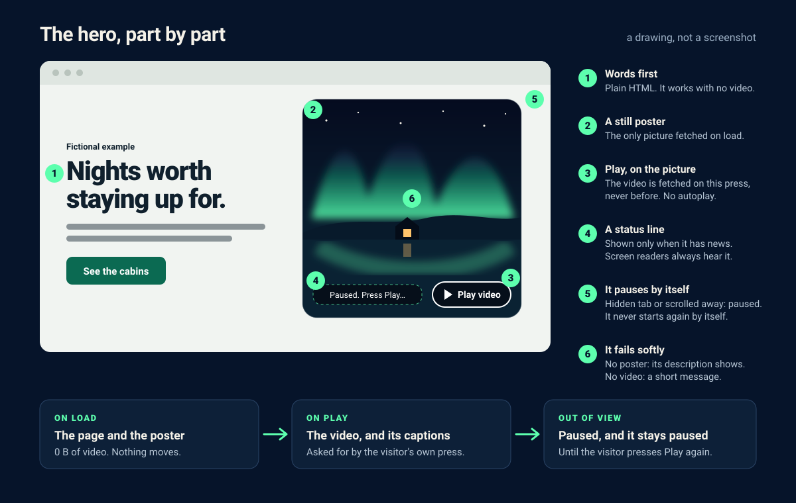

# Hero in Motion: guía

[English](quick-start.en.md) · [Volver al README](../README.md)



## 1. Genera la página de ejemplo

Necesitas Python 3.9 o posterior y un navegador. No se instala nada y nada se conecta a la red. Desde la raíz del repositorio:

```sh
mkdir -p output
python3 scripts/build_hero.py examples/hero.es.json --output output/hero-es.html
cp -f examples/poster-es.svg docs/lantern-lake.mp4 output/
python3 -m unittest discover -s tests -v
```

Es el ejemplo en español; para el inglés usa `examples/hero.json`, `examples/poster.svg` y `output/hero.html`. Deberías ver `Wrote output/hero-es.html` y que las pruebas terminan con `OK (skipped=16)`, o `OK (skipped=14)` si ya tienes FFmpeg instalado: las 14 pruebas de navegador necesitan Playwright y FFmpeg, y dos del inspector necesitan FFmpeg, así que solo se ejecutan cuando están instalados. Abre `output/hero-es.html` (`open` en macOS, `xdg-open` en Linux). Si los datos no son válidos, el script sale con código `2` y un mensaje `error:` de una línea. El generador no reemplaza un archivo existente (añade `--overwrite` para hacerlo) y nunca escribe sobre su propia entrada.

## 2. Prueba los fallos a propósito

La página está pensada para seguir siendo útil cuando algo falla. Prueba cada caso:

| Prueba | Qué deberías ver |
| --- | --- |
| Borra `output/lantern-lake.mp4`, recarga y pulsa **Reproducir video** (**Play video** si `lang` es `en`) | Un aviso sobre la imagen de que el video no está disponible; el cartel y el texto siguen ahí. |
| Borra `output/poster-es.svg` y recarga | Tu texto `poster_alt` en el panel en lugar del cartel (con JavaScript activado). |
| Activa «reducir movimiento» en tu sistema y recarga | Un aviso sobre la imagen de que nada se moverá hasta que pulses Reproducir, y el botón sigue funcionando. |
| Desactiva JavaScript y recarga | No aparecen el botón ni el aviso; titular, resumen, enlace y detalles siguen funcionando. |
| Pulsa Reproducir y cambia de pestaña o desplaza el panel fuera de la vista | Se pausa y no se reanuda solo al volver. |
| Deja que el video llegue al final | Vuelve el cartel con un aviso de que terminó, y Reproducir lo muestra de nuevo. |
| Recorre la página con el tabulador | Un contorno de foco visible en el enlace y en el botón. |

El video del ejemplo, `docs/lantern-lake.mp4`, es el que reproduce la [demo en vivo](https://augustobuilds.github.io/hero-in-motion/): la aurora del cartel, 10 segundos. Para generarlo tú, ejecuta `python3 scripts/render_film.py --format clip --output output/lantern-lake.mp4 --overwrite`. Necesita Playwright y FFmpeg, instalados como explica [make-the-film.md](make-the-film.md#en-español).

## 3. El contrato de configuración

Campos obligatorios:

| Campo | Qué admite |
| --- | --- |
| `lang` | `en` o `es` (o cualquier idioma del diccionario `UI` de `scripts/build_hero.py`). Fija el idioma de la página y las etiquetas del botón y de los avisos. Con `es`, escribe también en español todos los textos y el texto alternativo del cartel. |
| `title` | El título de la página. No se usa con `--fragment`, pero sigue siendo obligatorio. |
| `headline`, `summary` | El texto del hero. |
| `cta_label`, `cta_href` | La etiqueta del botón y su destino: una sección (`#precios`), una ruta de tu sitio (`/precios`, `./about.html`) o un enlace `https://`. |
| `video` | Una ruta simple a un `.mp4`, como `./hero.mp4` o `/assets/hero.mp4`. |
| `poster` | Una ruta simple a un `.svg`, `.jpg`, `.jpeg`, `.png`, `.webp` o `.avif`. |
| `poster_alt` | La descripción del cartel. Es el texto alternativo de la imagen y se muestra en su lugar si el cartel no carga. |

Campos opcionales:

| Campo | Qué añade |
| --- | --- |
| `badge` | Una línea corta sobre el titular, como «Nuevo» o «Ejemplo ficticio». |
| `details` | Una sección bajo el hero con el id `details`, para que `cta_href` pueda ser `#details`. |
| `layout` | `split` (texto junto a la imagen, por defecto), `stacked` (texto sobre la imagen) o `cover` (texto encima de una imagen a todo el ancho). |
| `ratio` | La forma de la imagen, como `16:9`, `4:3` o `1:1`. Por defecto, `1:1` con `split` y `16:9` con `stacked`. `cover` llena el hero y lo ignora. |
| `focus` | La parte de la imagen que debe seguir a la vista cuando se recorta, como dos porcentajes: a lo ancho y luego hacia abajo. `70% 40%` conserva un motivo a la derecha del centro. Por defecto, el centro. |
| `accent`, `accent_dark` | El color del botón y del contorno de foco, en modo claro y en modo oscuro, como `#0b5a9e`. El generador rechaza un color sobre el que no se leería la etiqueta del botón (necesita un contraste de 4,5 a 1). |
| `captions` | Una ruta simple a un archivo `.vtt`. Se descarga con el primer Reproducir y los subtítulos se muestran. |
| `video_webm` | Una ruta simple a una copia `.webm`. Los navegadores que pueden reproducirla la descargan en lugar del MP4. |
| `sound` | `true` reproduce el video con sonido y añade un botón Silenciar. Por defecto, `false`, se reproduce en silencio. |

Una ruta simple empieza por `./` o `/`, usa solo letras, dígitos, `-` y `_` en cada carpeta o archivo (se permiten subcarpetas) y termina en la extensión en minúsculas. Sin espacios ni puntos de más. Los textos llevan de 1 a 1000 caracteres (`badge`, 200) y no se aceptan otros campos.

Los archivos de video e imagen deben estar en tu propio sitio: se rechazan las URL remotas para ellos, y también los enlaces `javascript:` y `http://`, las rutas con `..` y los parámetros de consulta en las rutas de medios. Todos los valores se escapan como HTML y ninguno se inserta dentro del script; las etiquetas que necesita están en atributos `data-`.

## 4. Revisar un video real

Cuando tengas un video, colócalo junto a la página con el nombre indicado en `video` y revísalo:

```sh
python3 scripts/inspect_media.py output/lantern-lake.mp4 --check
```

El inspector usa un `ffprobe` que ya tengas instalado, le pasa los argumentos como lista (sin shell) y no descarga nada. Sin `--check` imprime los metadatos del flujo (códec, tamaño, fps, duración). Con `--check` además compara el archivo con el presupuesto de un hero (20 segundos como máximo, 300 kB por segundo como máximo, 1080 px de alto como máximo y el índice del MP4 al principio) e imprime el comando de FFmpeg que corrige lo que se pase. [Prepare your video](prepare-your-video.md) (en inglés) explica cada comprobación y cómo preparar la copia web, el cartel y los subtítulos.

Códigos de salida: `0` hay metadatos (y, con `--check`, todo pasó), `1` falló una comprobación, `2` falta el archivo, es una imagen fija o `ffprobe` no encuentra en él un flujo de video legible, y `3` no hay `ffprobe`. Nada de esto es una revisión de calidad: un valor de 60 fps no demuestra que los fotogramas sean distintos y no dice nada del contenido ni de los derechos.

## 5. Siguiente paso

- [Adapta la página](variations.md) (en inglés)
- [Prepara tu video](prepare-your-video.md) (en inglés)
- [Todos los archivos y solución de problemas](reference.md) (en inglés)
- [Instrucciones para un agente de código](../prompts/recreate-and-remix.md) (en inglés)

### Recursos afiliados (opcionales)

El autor de este kit también crea [ProcVideos](https://procvideos.com/) (ejemplos de videos hechos con código), [Attain OS](https://attainos.com/) (organiza briefs, tareas y documentos) y [AttainSoft](https://attainsoft.co/) (ingeniería a medida). Ninguno es necesario y el kit no les envía datos.
